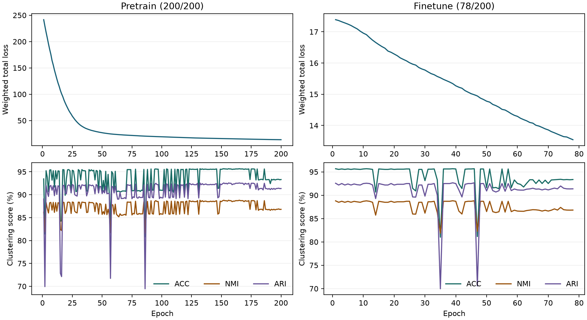

# scGTN Muraro 基线复现进度

截至 2026-11-23 12:05:20（北京时间）截取的记录显示，**预训练 200/200 轮，微调 78/200 轮**。最后一轮日志落盘时间为 2026-11-23 12:05:09。微调进行中，下表为截至快照的单次运行指标。

在 Apple Silicon MacBook Air 上使用 CPU 运行。环境为 Conda `ai4sci`、Python 3.11.18、PyTorch 2.15.0、Scanpy 1.11.5 和 Transformers 4.40.2。官方 Muraro 数据集包含 2,122 个细胞、19,046 个基因、9 类标签。预处理选取 2,000 个高变基因。官方提交为 `23fc3985e70a5a7def91057bfea896def83dcea3`，基础随机种子为 2023。训练副本加入逐轮记录和导出功能。 [官方源码](https://github.com/W-RMSL/scGTN/tree/23fc3985e70a5a7def91057bfea896def83dcea3)

## 实验快照

| 口径 | 轮次 | 总损失 | ACC | NMI | ARI |
| --- | ---: | ---: | ---: | ---: | ---: |
| 预训练最近一轮 | 200 | 13.6441 | 93.31% | 86.80% | 91.35% |
| 预训练当前最高 ACC 轮 | 132 | 16.7176 | 95.66% | 88.79% | 92.56% |
| 微调最近一轮 | 78 | 13.5452 | 93.36% | 86.82% | 91.36% |
| 微调当前最高 ACC 轮 | 1 | 17.3885 | 95.66% | 88.79% | 92.56% |

最高 ACC 轮的 NMI 和 ARI 取自该轮。官方实现使用真实标签 ACC 选择要恢复的预训练检查点，并选取微调报告轮次。论文 Muraro 结果为多次完整实验的均值 ± 标准差，ACC 96.02% ± 0.5 个百分点、NMI 89.15% ± 1.1 个百分点、ARI 93.10% ± 0.9 个百分点。 [论文表 1](https://arxiv.org/html/2606.18672v1#S3.T1)

## 复现记录

- 最新快照含逐轮 CSV、训练日志、配置、环境、数据检查、预处理输出和代码差异。 [实验记录](results/scgtn_muraro_baseline/)
- 昨晚为导师整理的报告保留预训练第 33 轮时的观察与耗时图。 [阶段性报告](scgtn_muraro_progress/report.md) · [进度摘要](scgtn_muraro_progress/summary.md) · [当时的待办](scgtn_muraro_progress/checklist.md)
