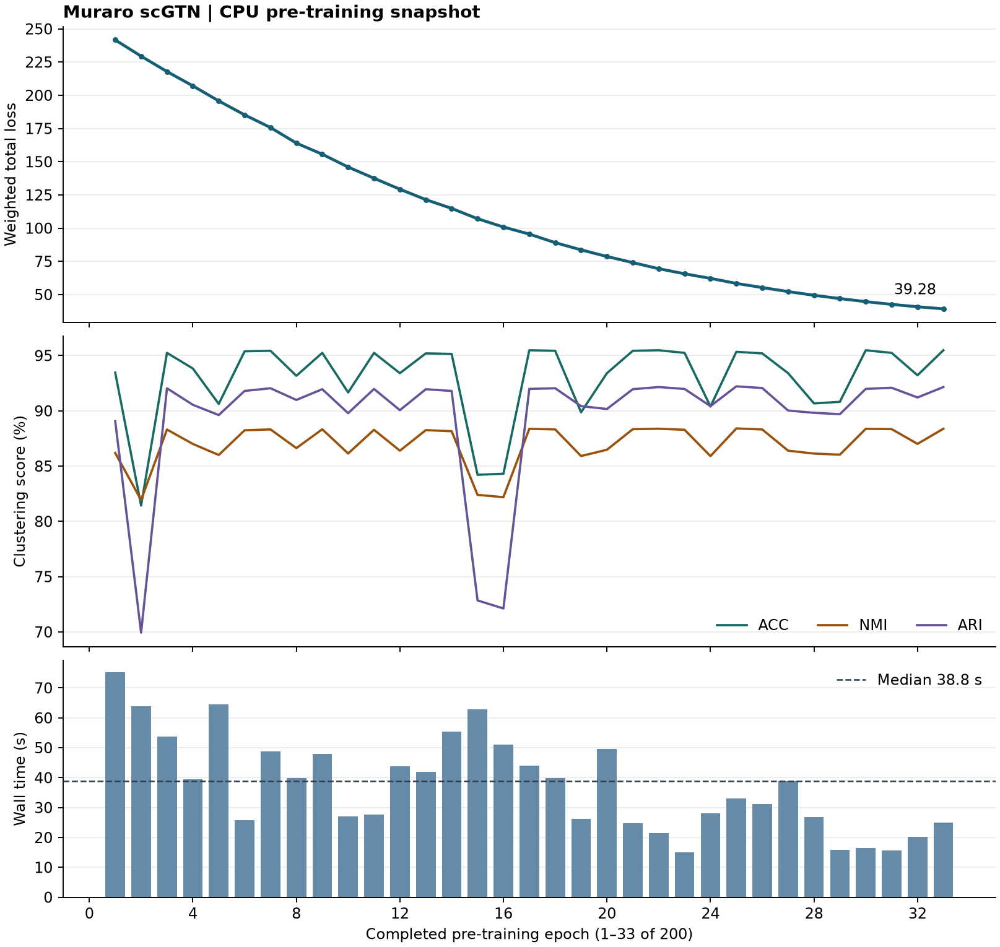

# scGTN Muraro 阶段性复现报告

**截至 2026-11-22 21:33:26（北京时间），预训练完成 33/200 轮（16.5%），微调 0/200 轮。** 本次已验证官方数据可完成预处理、双视图前向传播、训练前 KMeans 和部分预训练。预训练后的中心重置、OTC 微调与最终结果仍待验证。

## 1. 实验状态与记录核对

| 文件 | 当日最后写入（北京时间） | 截取时记录 |
| --- | --- | --- |
| `metrics.csv` | 21:33:18 | 33 条连续预训练记录，微调 0 条。以此确定进度。 |
| `training.log` | 21:33:18 | 预训练 33/200 轮，最近总损失 39.2839，与 CSV 四位小数一致。 |
| 原 `reproduction_report.md` | 21:21:22 | 预训练 11/200 轮，微调 0/200 轮，属于较早快照。 |
| `code_changes.md` | 21:18:46 | 记录日志和导出副本的差异、环境选择和执行命令。 |

训练日志与 CSV 的完成轮次一致。原报告比 CSV 少 22 轮，来自文件更新时间不同。CSV 截取内容的 SHA-256 为 `a1aaf080b369331b47c49e9d5bfc398897c42aef05fe2632b3e367b60fda3529`。本报告单独保存，所有原始记录按各自生成时刻留存。 [逐轮记录](../results/scgtn_muraro_baseline/metrics.csv) · [训练日志](../results/scgtn_muraro_baseline/training.log) · [原报告](../results/scgtn_muraro_baseline/reproduction_report.md) · [代码差异](../results/scgtn_muraro_baseline/code_changes.md)

实际产物包括 `code_changes.md, config.json, dataset_info.txt, environment.txt, metrics.csv, preprocessing_log.txt, reproduction_report.md, training.log`。检查点目录为空。以下文件尚未生成，`summary.json`, `training_curves.png`, `confusion_matrix.png`, `cluster_results.csv`, `official_best_predictions.npz`。本报告所附图表由阶段性 CSV 快照生成。

| 证据级别 | 内容 |
| --- | --- |
| 已实际运行验证 | CPU 环境、依赖导入与检查、H5 结构与行对齐、双视图张量和 CPU 前向、训练前 KMeans、33 轮预训练及每轮损失与指标。 |
| 源码确认 | 构图与编码路径、有效参数、损失组合、按标签 ACC 选择检查点和微调报告轮次。 |
| 待当前运行验证 | 预训练完成及最佳权重恢复、融合嵌入重新做 KMeans、OTC 微调、最终评估与产物导出。 |

## 2. 方法与架构

scGTN 对同一表达矩阵构造两个细胞图视图，用局部邻域和最短路径信息学习细胞嵌入。当前提交将归一化表达分别送入共用权重的 GAT。两条 Transformer 分支各自实例化，结构相同、参数分别学习。每个细胞以中心节点和 15 个邻居形成长度 16 的序列，由 GAT 特征线性投影、位置嵌入和最短路径嵌入相加形成输入。每条分支沿序列平均池化，每细胞得到 256 维向量。两个向量以 sigmoid 参数加权融合，逐轮 KMeans 评估使用融合嵌入，微调目标设计也使用该嵌入。 [论文方法](https://arxiv.org/html/2606.18672v1#S2) · [模型源码](https://github.com/W-RMSL/scGTN/tree/23fc3985e70a5a7def91057bfea896def83dcea3/model.py)

## 3. Muraro 数据、预处理与双视图

实测官方 H5 的 CSR 表达矩阵含 2,122 个细胞、19,046 个基因，标签来自 `obs/cell_type1`，共 9 类。原始矩阵零值占 73.02%，无负值、NaN 或 Inf。原始非零表达包含小数，ZINB 使用官方读取为 float32 后保留的表达层。类别大小从 3 到 812。

官方流程保留原始表达层，按至少 3 个细胞表达过滤基因，按总表达阈值 1 过滤细胞。过滤后为 2,122 × 17,500。每个细胞归一化至 10,000 后取 `log1p`，通过 Seurat 方法保留 2,000 个高变基因。保留表达层与标签分别同原始加载矩阵切片及细胞行对应。

源码显示，基础图由余弦相似度 15-NN 构造并对称化。第一视图按相似度阈值去除最低权重的一组边（设定比例 0.1），加自环并对称归一化。第二视图对加自环的归一化基础图做 PPR 扩散（α = 0.2），对称化后把低于均值加 0.5 倍标准差的项置零。两视图分别按权重取 Top-K，并在正权重边图上用最短路径计算 Hop IDs。位置 ID 为序列中的 0–15。

| 实测项目 | 边扰动视图 | PPR 视图 |
| --- | ---: | ---: |
| 邻接形状 | 2,122 × 2,122 | 2,122 × 2,122 |
| 非零矩阵项（含对角线） | 52,406 | 107,300 |
| 非零矩阵项（不含对角线） | 50,284 | 105,178 |
| Top-K 邻居索引 | 2,122 × 15 | 2,122 × 15 |
| Hop IDs、Position IDs | 2,122 × 16 | 2,122 × 16 |
| 预处理构造的表达子图 | 2,122 × 16 × 2,000 | 2,122 × 16 × 2,000 |
| GAT 后实际 Transformer 输入 | 2,122 × 16 × 256 | 2,122 × 16 × 256 |
| 平均池化嵌入 | 2,122 × 256 | 2,122 × 256 |

GAT 使用邻接非零项生成边索引，边权影响 Top-K 和图重建目标。官方前向根据 GAT 输出重新构造子图，预处理所存的加噪表达子图在这一路径中被替换。 [数据检查](../results/scgtn_muraro_baseline/dataset_info.txt) · [实测形状与有限值](../results/scgtn_muraro_baseline/preprocessing_log.txt) · [预处理源码](https://github.com/W-RMSL/scGTN/tree/23fc3985e70a5a7def91057bfea896def83dcea3/preprocess.py) · [邻居与 Hop 源码](https://github.com/W-RMSL/scGTN/tree/23fc3985e70a5a7def91057bfea896def83dcea3/utils.py)

## 4. 实验配置与训练损失

Apple Silicon MacBook Air，macOS 15.6，使用 CPU，未使用 NVIDIA GPU 或 MPS。Conda 环境 `ai4sci`，Python 3.11.18、PyTorch 2.15.0、PyG 2.8.1、Transformers 4.40.2、Scanpy 1.11.5、NumPy 2.4.6，PyTorch 记录为 4 个 CPU 线程。配置记录开始于 `2026-11-22T21:12:37.125756+08:00`。

| 参数 | 实际设置 |
| --- | --- |
| 训练 | 全图，Adam，学习率 1.3e−5，权重衰减 5e−4，梯度裁剪阈值 5 |
| 轮数 | 预训练 200，微调 200 |
| GAT / Transformer | GAT 4 头。Transformer 每分支 6 层、2 头、隐藏维度 256、前馈维度 512。两者 dropout 0.1 |
| 构图与序列 | 有效邻居数 15。命令行 `k=20` 未用于此路径，实际 `model_config.k=15` |
| 基础种子 | 2023。NumPy 2023、Python random 2024、PyTorch 2025、源码调用 CUDA 种子 2026 |
| KMeans | 两次初始化各设 20 次重启、种子 2021。每轮评估 5 次重启，使用 NumPy 全局随机状态 |

训练前第一视图 KMeans 已执行，日志记录 inertia 为 16,183.38867188。预训练目标为 **0.75 × 双视图相关性 + 1.5 × ZINB 表达重建 + 0.45 × 图重建**。相关损失近似对齐两视图各嵌入维度，非对角系数为 0.0015。ZINB 使用两视图共享的解码器，图损失对归一化嵌入的成对余弦相似度和目标邻接做均方误差。

源码预定在预训练结束后恢复最高 ACC 的权重，用融合嵌入重新做 KMeans 并写入聚类中心。微调将在上述损失上加入 1.5 × OTC，使用 Student-t 软分配和 3 次 Sinkhorn 迭代构造目标分配，温度为 1.0。当前 CSV 的 OTC 始终为零，与预训练关闭该项一致。

官方来源为 `W-RMSL/scGTN` 的 `main`，归档提交 `23fc3985e70a5a7def91057bfea896def83dcea3`。训练使用独立入口副本 `work/scGTN_logged.py`，配合 `baseline_logging.py` 添加观测、有限值检查和导出。Transformers 固定在与原 BERT 接口匹配的 4.40.2。 [完整配置](../results/scgtn_muraro_baseline/config.json) · [环境](../results/scgtn_muraro_baseline/environment.txt) · [代码修改记录](../results/scgtn_muraro_baseline/code_changes.md) · [官方入口](https://github.com/W-RMSL/scGTN/tree/23fc3985e70a5a7def91057bfea896def83dcea3/scGTN_main.py) · [损失源码](https://github.com/W-RMSL/scGTN/tree/23fc3985e70a5a7def91057bfea896def83dcea3/layer.py)

## 5. 当前耗时、损失与聚类指标

已记录的相邻日志点耗时累计 20.69 分钟，平均 37.61 秒/轮，中位数 38.78 秒，范围 15.10–75.37 秒。首条计时从日志对象建立算起，包含训练前 KMeans 等开销。其余值是相邻记录点的墙钟间隔，含逐轮评价相关开销。

总损失从 **241.6577** 到 **39.2839**，逐轮下降，端点降幅 83.74%。降幅主要来自双视图相关性项，未加权值从 310.7886 降至 41.2491。ZINB 从 5.2905 到 5.1637，图重建从 1.4013 到 1.3368。损失下降期间聚类指标仍逐轮波动。

ACC 是匈牙利对齐后的准确率，NMI 衡量分组间归一化的共享信息，ARI 是校正随机一致性后的分组一致度。下表中的“最高 ACC 轮”按官方严格大于规则取首个最高值，同行 NMI、ARI 取自该轮。

| 记录口径 | ACC | NMI | ARI |
| --- | ---: | ---: | ---: |
| 预训练第 1 轮 | 93.45% | 86.19% | 89.07% |
| 预训练第 33 轮（最近） | 95.48% | 88.38% | 92.15% |
| 当前最高 ACC 轮（第 17 轮） | 95.48% | 88.37% | 91.98% |
| 论文表 1 · Muraro（均值 ± 标准差） | 96.02% ± 0.5 个百分点 | 89.15% ± 1.1 个百分点 | 93.10% ± 0.9 个百分点 |

最近一轮与论文均值的描述性差值为 -0.54、-0.77、-0.95 个百分点，依次对应 ACC、NMI、ARI。当前值来自单种子、单次运行的预训练前段。论文值来自完整方法的多次运行均值和标准差。当前差值只能用于汇报当前量级，复现结论和跨种子方差仍待评估。 [论文表 1](https://arxiv.org/html/2606.18672v1#S3.T1)

## 6. 影响结果解读的问题

- **真实标签参与选择。** 原始标签不进入梯度损失或 KMeans 拟合，但其类别数决定聚类数。官方每轮用真实标签算 ACC，据此挑选并恢复预训练权重，影响微调起点。微调的报告轮次也按真实标签 ACC 选取。指标因此受标签驱动的选择影响。
- **评估时序。** 每轮聚类使用训练模式下优化器更新前的嵌入，融合系数在更新后读取。重新加载更新后的权重推理时，预测可能不同。
- **邻居重复与零权重。** 实测两视图分别有 1,796 和 2,122 行的中心节点又进入 Top-K。边扰动视图包含 2,613 个零权重邻居槽位。
- **目标分布与表达值。** Muraro 类别不均衡，源码 OTC 在默认情况下使用均匀目标边缘。该设定对本次数据的微调影响尚待观察。ZINB 使用 H5 中经转换保留的非整数表达值。

## 7. 下一步

等待当前任务完成 200 轮预训练，核对最佳权重恢复和第二次 KMeans。确认 OTC 微调的 200 轮、各项有限值和最终耗时，再核验逐细胞预测、混淆矩阵、曲线与权重。最终报告分别列出官方最高 ACC 轮及最后一轮，随后对照论文统计口径。 [待完成事项](checklist.md)

## 附录 · 已记录的每轮耗时和指标

| 预训练轮次 | 墙钟秒数 | 总损失 | ACC | NMI | ARI |
| ---: | ---: | ---: | ---: | ---: | ---: |
| 1 | 75.37 | 241.6577 | 93.45% | 86.19% | 89.07% |
| 2 | 63.98 | 229.4264 | 81.43% | 81.94% | 69.94% |
| 3 | 53.72 | 217.8361 | 95.24% | 88.31% | 92.04% |
| 4 | 39.54 | 207.0666 | 93.83% | 87.00% | 90.54% |
| 5 | 64.51 | 195.7283 | 90.62% | 86.01% | 89.61% |
| 6 | 25.72 | 185.2519 | 95.38% | 88.24% | 91.80% |
| 7 | 48.75 | 175.7181 | 95.43% | 88.32% | 92.04% |
| 8 | 39.93 | 163.9895 | 93.17% | 86.63% | 90.98% |
| 9 | 48.03 | 155.6198 | 95.24% | 88.33% | 91.95% |
| 10 | 27.09 | 145.9680 | 91.66% | 86.14% | 89.78% |
| 11 | 27.72 | 137.5427 | 95.24% | 88.28% | 91.98% |
| 12 | 43.89 | 129.2816 | 93.40% | 86.39% | 90.06% |
| 13 | 41.92 | 121.4710 | 95.19% | 88.25% | 91.95% |
| 14 | 55.42 | 114.8384 | 95.15% | 88.15% | 91.80% |
| 15 | 62.90 | 107.0969 | 84.21% | 82.40% | 72.85% |
| 16 | 51.05 | 100.8526 | 84.31% | 82.19% | 72.12% |
| 17 | 44.07 | 95.5237 | 95.48% | 88.37% | 91.98% |
| 18 | 39.87 | 89.0633 | 95.43% | 88.32% | 92.04% |
| 19 | 26.11 | 83.6614 | 89.87% | 85.91% | 90.42% |
| 20 | 49.56 | 78.6761 | 93.40% | 86.48% | 90.16% |
| 21 | 24.68 | 74.0589 | 95.43% | 88.34% | 91.96% |
| 22 | 21.48 | 69.4793 | 95.48% | 88.38% | 92.15% |
| 23 | 15.10 | 65.6383 | 95.24% | 88.28% | 91.98% |
| 24 | 28.06 | 62.2042 | 90.39% | 85.90% | 90.42% |
| 25 | 32.93 | 58.3837 | 95.33% | 88.40% | 92.21% |
| 26 | 31.14 | 55.2958 | 95.19% | 88.31% | 92.06% |
| 27 | 38.78 | 52.2601 | 93.40% | 86.39% | 90.02% |
| 28 | 26.73 | 49.4761 | 90.67% | 86.13% | 89.82% |
| 29 | 15.93 | 47.0041 | 90.81% | 86.03% | 89.70% |
| 30 | 16.46 | 44.6768 | 95.48% | 88.37% | 91.98% |
| 31 | 15.65 | 42.6198 | 95.24% | 88.35% | 92.09% |
| 32 | 20.23 | 40.8361 | 93.21% | 87.01% | 91.21% |
| 33 | 24.90 | 39.2839 | 95.48% | 88.38% | 92.15% |
